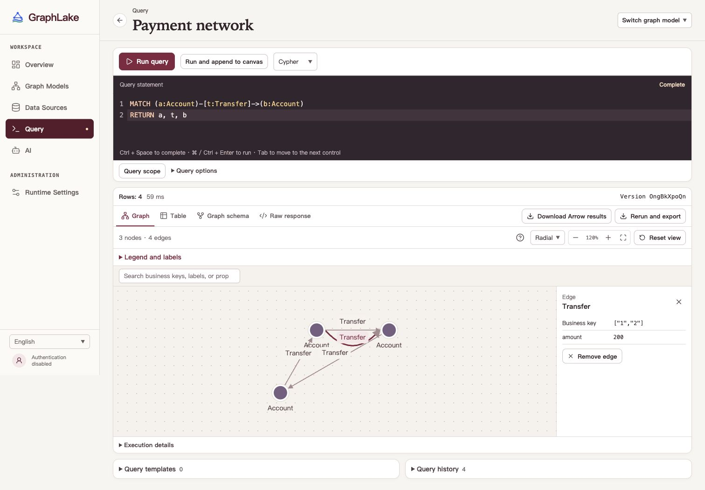
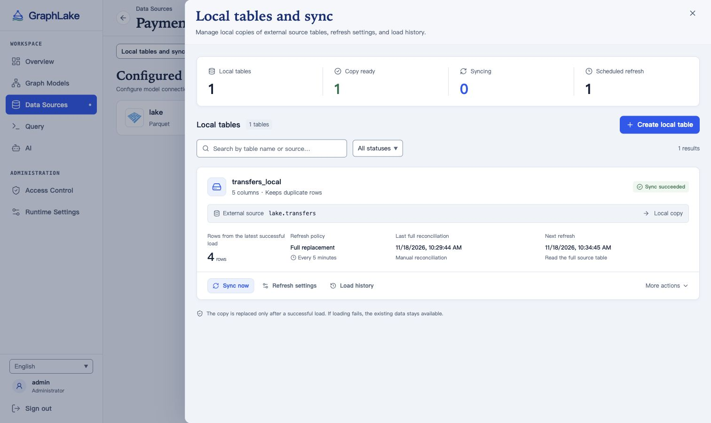
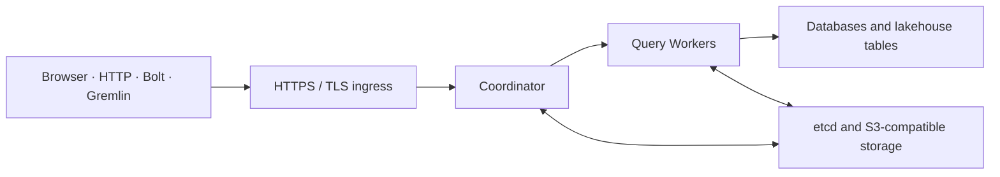

<p align="center">
  
</p>

<h1 align="center">GraphLake</h1>

<p align="center"><strong>Read-only graph analytics across databases and lakehouse tables</strong></p>

<p align="center">
  <a href="https://github.com/SamuelSupe/graphlake/releases/latest"><strong>Download for Linux</strong></a> ·
  <a href="docs/quickstart.md">Quickstart</a> ·
  <a href="docs/deployment.md">Deployment</a> ·
  <a href="docs/reference.zh-CN.md">中文技术参考</a>
</p>

Build a graph over existing tables, query it with **Cypher**, **SQL**, or **Gremlin**, and explore nodes and relationships in your browser. Run GraphLake as an embedded Rust engine, a standalone Linux service, or a Coordinator with distributed Workers.

[](docs/images/query-workbench-en.jpg)

*The Cypher workbench displays the accounts and transfers from the built-in Parquet demo (earlier console layout).*

## Try the Parquet demo

The [quickstart](docs/quickstart.md) creates two small Parquet files and opens the workbench. Run this query in the CLI or browser to find two-hop transfers from account `10`.

```cypher
MATCH (a:Account)-[:Transfer]->(b:Account)-[t:Transfer]->(c:Account)
WHERE a.tenant_id = 1 AND a.account_id = 10
RETURN c.account_id AS account, count(*) AS paths, sum(t.amount) AS amount
```

The result is account `30`, with two paths and a total amount of `600`.

## What you can do

| Workflow | What GraphLake provides |
| --- | --- |
| **Model** | Map tables to node labels and relationship types with composite keys, property mappings, filters, and business-time rules. Validate and publish drafts or roll back to an archived version. |
| **Query and explore** | Inspect properties and expand neighbors in the graph view. Set query timeouts, inspect model and source versions, and export results as Arrow IPC. |
| **Analyze** | Run bounded traversals, shortest paths, PageRank, weakly connected components, community detection, and Node2Vec. Reuse persisted CSR indexes for supported workloads. |
| **Connect AI** | Use [separate MCP services for querying and modeling](docs/mcp.md). Personal AI tokens inherit the owner’s current model permissions and tenant scope. |
| **Sync locally** | Load selected source columns into managed Parquet tables and refresh them incrementally by key and watermark. |
| **Operate** | Manage users, service accounts, and model-level roles. Collect audit events, Prometheus metrics, and OTLP signals. Restore from an off-site checkpoint. |

The browser console defaults to English and supports Simplified Chinese. Choose an interface language on the sign-in page or in the main navigation. The browser remembers your choice. Use the theme switch in the main navigation to choose a light or dark appearance. Open a model to access its Graph Models, Data Sources, and Query workspaces.

## Local tables and data sync

Open **Local tables** from a graph model to load selected source columns into a managed Parquet copy. Run full or incremental refreshes on demand or on a schedule. The panel shows the last refresh, the next scheduled run, and load history.

[](docs/images/local-tables-en.jpg)

A refresh publishes the new copy atomically. The last committed copy remains available if a load fails before publication. Use a full reload to reflect rows deleted at the source. [Local tables and data sync guide](docs/local-tables.zh-CN.md)

## Install on Linux

The GitHub release ships **ARM64 (`aarch64`)** and **AMD64 (`x86_64`)** packages for Debian 12 and compatible glibc-based Linux systems. Each package contains `graphlake`, `graphlake-admin`, the compiled browser UI, and deployment assets for systemd and HAProxy.

1. Run `uname -m` and download the matching `.tar.gz` and `.tar.gz.sha256` from the release page.
2. Verify the checksum and extract the package. Each archive contains a `BUILD-INFO` file with its commit, source digest, and target architecture.
3. Use the [standalone deployment guide](docs/deployment.md#standalone-service) for installation, administrator setup, and the first health check.

## Data sources and interfaces

- **Direct connectors** — PostgreSQL, MySQL, SQLite, CSV, JSON Lines, Parquet, Iceberg, Delta Lake, Snowflake, BigQuery, ClickHouse, Trino, Spanner, and SAP HANA.
- **Additional direct connectors** — SQL Server (TDS), Oracle (Oracle Instant Client required), MongoDB, DuckDB, Databricks SQL, Apache Doris, StarRocks, TiDB, OceanBase MySQL mode, and MariaDB.
- **Per-connection object storage** — S3, MinIO, OSS (S3-compatible authentication), TOS (S3 endpoint), COS, Azure Blob Storage, and GCS. Browse object keys and map Parquet, CSV, or JSON Lines files; credentials remain server-side environment references.
- **Through Trino** — SQL Server, Oracle, Hive, Hudi, MongoDB, Elasticsearch, and Redshift. The corresponding Trino catalog supplies access to the source. SQL Server and Oracle have dedicated `sqlserver` and `oracle` configuration choices.
- **Clients** — Browser, HTTP API and MCP, Bolt and Gremlin WebSocket, command line, embedded Rust, and source-built Python and C bindings. Explicit Bolt transactions are available for PostgreSQL and Parquet.

In **Data Sources**, use **Configure** on a source row to edit its connection, then save and publish the model draft.

See the [technical reference](docs/reference.zh-CN.md#图映射与连接器) for source configuration, query semantics, the API, and the bindings.

## Deployment modes



Use one `graphlake-admin` process for a standalone deployment. A distributed deployment adds Workers for supported scans, joins, aggregations, and graph operations. Coordinator failover uses etcd for leadership and S3-compatible storage for published control state. Both modes serve read-only queries over data owned by the underlying sources.

## Documentation

| Guide | Covers |
| --- | --- |
| [Quickstart](docs/quickstart.md) | Build from source, run the Parquet demo, and open the browser workbench |
| [Deployment](docs/deployment.md) | Linux installation, TLS, upgrade and rollback, monitoring, and recovery |
| [Cluster reference](deploy/cluster.md) | Coordinator and Worker configuration, distributed execution, failover, and recovery manifests |
| [Monitoring reference](deploy/monitoring.md) | Service, source, ingress, telemetry, and backup probes |
| [Technical reference](docs/reference.zh-CN.md) | Modeling, connectors, query behavior, algorithms, APIs, and bindings |
| [MCP server](docs/mcp.md) | AI client connection, query and modeling tools, permissions, and protocol scope |
| [Local tables and data sync](docs/local-tables.zh-CN.md) | Full loads, incremental refresh, scheduling, and snapshot recovery |
| [Production optimization plan](docs/production-optimization-plan.zh-CN.md) | Proposed source-read, incremental-sync, freshness, algorithm-capacity, recovery, and release-gate improvements |
| [Changelog](CHANGELOG.md) | Release highlights and runtime boundaries |
