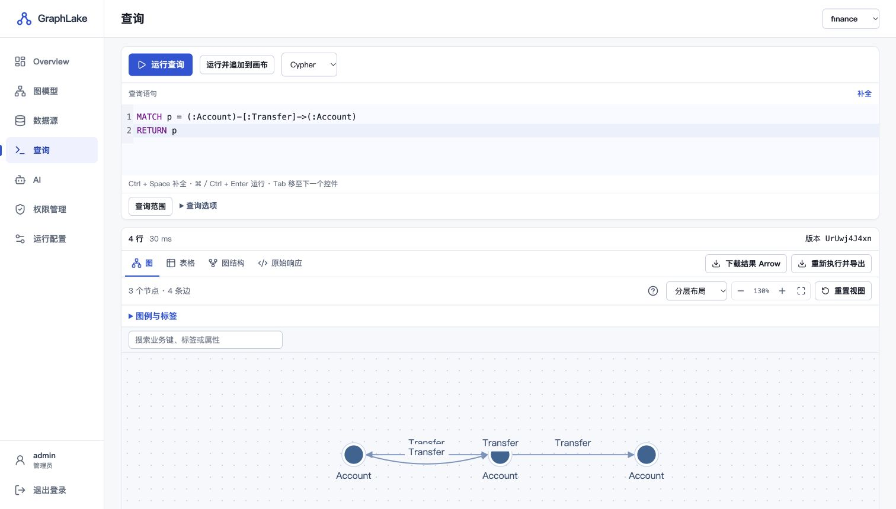
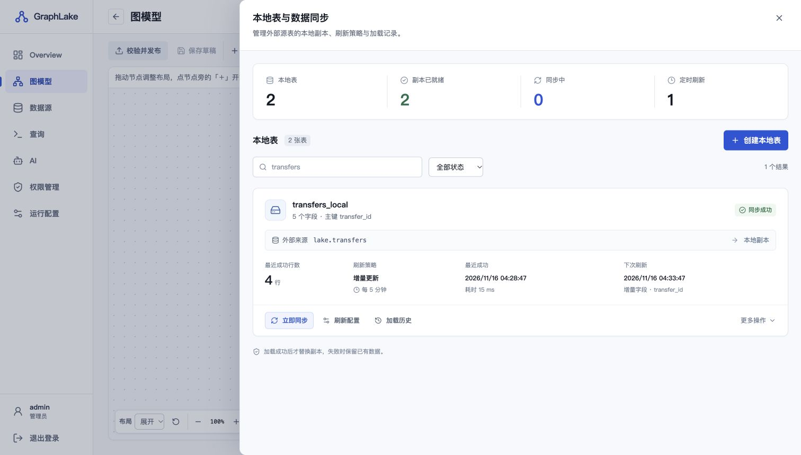
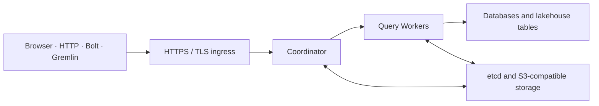

# GraphLake

**Read-only graph analytics across databases and lakehouse tables.**

Build a labeled graph over existing tables, query it with Cypher, SQL, or Gremlin, and explore the results in a browser. GraphLake runs as an embedded Rust engine, a standalone Linux service, or a Coordinator with distributed Workers.

[**Download v1.1.0**](https://github.com/SamuelSupe/graphlake/releases/tag/v1.1.0) · [Quickstart](docs/quickstart.md) · [Deployment](docs/deployment.md) · [中文技术参考](docs/reference.zh-CN.md)



## What you can do

| | |
| --- | --- |
| **Model** | Map nodes and relationships to one or more tables, with composite keys, property mappings, filters, business-time rules, and validation. Publish a draft or roll back to an archived version. |
| **Query** | Use Cypher, SQL, or Gremlin. Set a timeout, inspect the model and source versions, cancel a query, or export complete results as Arrow IPC. |
| **Explore** | Inspect node and relationship properties, expand and page through neighbors, search across batches, and continue loading a truncated graph preview. |
| **Analyze** | Run bounded traversals, shortest paths, PageRank, weakly connected components, community detection, and Node2Vec. Reuse persisted CSR indexes for supported workloads. |
| **Connect AI** | Connect Agents to separate query and modeling MCP services through an in-app guide. Personal AI tokens inherit the owner’s live model permissions and tenant scope; administrators set global capability limits. |
| **Sync locally** | Load selected source fields into managed Parquet tables, refresh incrementally by key and watermark, and schedule refreshes. |
| **Operate** | Manage users, service accounts, and model-level roles. Collect audit events, Prometheus metrics, and OTLP signals. Restore an off-site checkpoint and verify a known business query before enabling traffic. |

The browser console defaults to English and supports Simplified Chinese. Choose an interface language on the sign-in page or in the main navigation. The browser remembers your choice.

## Local tables and data sync

In GraphLake 1.1.0, open **Local Tables** (本地表) from a graph model to load selected source columns into a managed Parquet copy. Run full or incremental refreshes on demand or on a schedule. Incremental refresh uses a primary key and watermark. The panel shows which copies are ready, when they last refreshed, and when the next run is due. Load history records each run’s outcome and row counts.



A refresh publishes the new snapshot atomically. If a load fails before publication, the last committed copy stays available. Use a full reload to reflect rows deleted at the source. [Local tables and data sync guide](docs/local-tables.zh-CN.md)

## Install on Linux

The GitHub release ships **ARM64 (`aarch64`)** and **AMD64 (`x86_64`)** packages for Debian 12 and compatible glibc-based Linux systems. Each package contains `graphlake`, `graphlake-admin`, the compiled browser UI, and deployment assets for systemd and HAProxy.

1. Run `uname -m` and download the matching `.tar.gz` and `.tar.gz.sha256` from the release page.
2. Verify the checksum and extract the package. Each archive contains a `BUILD-INFO` file with its commit, source digest, and target architecture.
3. Use the [standalone deployment guide](docs/deployment.md#standalone-service) for installation, administrator setup, and the first health check.

For local development and a runnable example, follow the [quickstart](docs/quickstart.md). It builds a graph from two small Parquet files and runs this query through the CLI and the browser:

```cypher
MATCH (a:Account)-[:Transfer]->(b:Account)-[t:Transfer]->(c:Account)
WHERE a.tenant_id = 1 AND a.account_id = 10
RETURN c.account_id AS account, count(*) AS paths, sum(t.amount) AS amount
```

The example returns account `30`, two paths, and a total amount of `600`.

## Data sources and interfaces

- **Direct connectors** — PostgreSQL, MySQL, SQLite, CSV, JSON Lines, Parquet, Iceberg, Delta Lake, Snowflake, BigQuery, ClickHouse, Trino, Spanner, and SAP HANA.
- **Additional direct connectors** — SQL Server (TDS), Oracle (Oracle Instant Client required), MongoDB, DuckDB, Databricks SQL, Apache Doris, StarRocks, TiDB, OceanBase MySQL mode, and MariaDB.
- **Per-connection object storage** — S3, MinIO, OSS (S3-compatible authentication), TOS (S3 endpoint), COS, Azure Blob Storage, and GCS. Browse object keys and map Parquet, CSV, or JSON Lines files; credentials remain server-side environment references.
- **Through Trino** — SQL Server, Oracle, Hive, Hudi, MongoDB, Elasticsearch, and Redshift. The corresponding Trino catalog supplies access to the source. SQL Server and Oracle have dedicated `sqlserver` and `oracle` configuration choices.
- **Clients** — Browser, HTTP API and MCP, Bolt and Gremlin WebSocket, command line, embedded Rust, and source-built Python and C bindings. Explicit Bolt transactions are available for PostgreSQL and Parquet.

Configure sources directly from connector cards in the **Data Sources** workspace, then save and publish the model draft.

See the [technical reference](docs/reference.zh-CN.md#图映射与连接器) for source configuration, query semantics, the API, and the bindings.

## Deployment modes



Use one `graphlake-admin` process for a standalone deployment. A distributed deployment adds Workers for supported scans, joins, aggregations, and graph operations. Coordinator failover uses etcd for leadership and S3-compatible storage for published control state. Both modes serve read-only queries over data owned by the underlying sources.

## Documentation

| Guide | Covers |
| --- | --- |
| [Quickstart](docs/quickstart.md) | Build from source, run the Parquet demo, and open the browser workbench |
| [Deployment](docs/deployment.md) | Linux installation, TLS, upgrade and rollback, monitoring, and recovery |
| [Cluster reference](deploy/cluster.md) | Coordinator and Worker configuration, distributed execution, failover, and recovery manifests |
| [Monitoring reference](deploy/monitoring.md) | Service, source, ingress, telemetry, and backup probes |
| [Technical reference](docs/reference.zh-CN.md) | Modeling, connectors, query behavior, algorithms, APIs, and bindings |
| [MCP server](docs/mcp.md) | AI client connection, query and modeling tools, permissions, and protocol scope |
| [Local tables and data sync](docs/local-tables.zh-CN.md) | Full loads, incremental refresh, scheduling, and snapshot recovery |
| [Changelog](CHANGELOG.md) | Release highlights and runtime boundaries |
