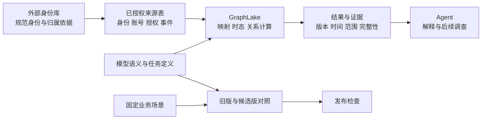

# Agent 业务语义与模型变更影响验证方案

阶段 1 的语义字段与类型查询，以及阶段 2 的参数化任务、固定数据回归及服务端发布检查已实现。工作台支持启用任务、由管理员维护固定套件，并在发布与回退前查看逐场景的结果和证据差异。当前接口见 [MCP 文档](../mcp.md#business-context-in-get_schema)和[安全分析任务](../security-tasks.md)。阶段 3 的线上对照仍为设计。

建议在现有模型上增加可选语义元数据，补齐查询 schema 的类型信息，并将少量业务问题做成随模型发布的参数化任务。模型发布前，用同一份固定数据运行旧版和候选版任务，检查业务结论、证据和覆盖范围的变化。继续使用现有查询与建模 MCP、权限、草稿和发布版本，不另建语义服务。

外部身份库提供规范身份及归属依据；GraphLake 计算这些身份与账号、设备、资源、事件之间的关系，并返回可追溯证据。共享 IP、设备共用或相似行为只作为关联线索，不自动生成身份归并结论。

## 方案提出时的基础与缺口

| 已有能力 | 本次需要补齐的内容 |
| --- | --- |
| `Catalog`、`Node`、`Edge` 保存映射，拒绝未知字段 | 新增可选语义结构，旧模型保持可读；当前版本不能直接加载本提案的 YAML |
| `get_schema` 返回标签、属性名称、业务键和关系端点 | 返回逻辑属性类型、可空性、业务含义、单位、时态及证据约定 |
| `validate_model` 经 `inspect_model` 返回映射后的字段类型，并可检查键和端点 | 复用类型解析能力；增加语义引用检查与业务回归 |
| SCD2、业务时点、来源版本和只读参数化 Cypher | 将时点和证据要求纳入任务契约，明确结果的适用范围 |
| 草稿、归档、发布、回滚、版本冲突检查 | 将语义和任务一起版本化，让发布检查绑定准确的候选版本 |
| 版本页展示字段摘要与 YAML 差异 | 增加业务结果、证据路径和影响任务的对照 |
| 浏览器中的查询模板存于 `localStorage` | 增加服务端维护、带参数约束和回归用例的任务；个人模板保持原用途 |

代码依据：[模型结构](../../src/catalog.rs)、[schema 与校验](../../src/admin/models.rs)、[MCP 工具](../../src/admin/mcp/tools.rs)、[发布与回滚](../../src/admin/models/versions.rs)、[时态执行](../../src/engine/model.rs)、[查询模板](../../web/src/Query.tsx)。用户提供的 [schema 历史版本](https://github.com/SamuelSupe/graphlake/blob/6857b723de2f7cdad5955a8ddb0afc5719e494d3/src/admin/models.rs) 中指出的类型与语义缺口，在本方案基线中仍存在。

## 业务分工与结论边界



首批安全模型采用下列关系类别。这是帮助解释和检查任务前提的分类，不是自动推理规则，也不限制其他行业使用自定义关系。

| 关系示例 | 可以支持的陈述 | 不能直接推出的陈述 |
| --- | --- | --- |
| `Account -> USES_IP -> IP` | 指定时间窗口内观察到账号使用某 IP | 两个账号属于同一自然人 |
| `Account -> IDENTIFIED_AS -> Person` | 外部身份库在指定有效期内声明账号归属 | 由 IP、姓名或邮箱相同即可自行合并身份 |
| `Account -> GRANTED -> Resource` | 来源中存在某项授权，或沿角色路径可达资源 | 当前一定能够成功访问；已处理所有拒绝策略、账号状态和条件策略 |
| `Account -> ACCESSED -> Resource` | 某事件记录了一次访问；成功与失败由事件结果区分 | 现在仍有权限；拥有某授权就一定使用过 |

身份键至少包含命名空间和外部稳定标识，并继承租户范围。身份库的合并、拆分、账号转交及规则版本作为来源事实保留；GraphLake 不覆盖它们。若来源不能提供历史身份归属，告警历史关联必须标注该限制。

“离职账号还能访问哪些资源”在第一版界面中细化为“离职账号的残留授权与离职后访问记录”。若只有授权表，输出“残留授权”；只有成功事件，输出“在某时刻成功访问过”。只有接入具备明确覆盖范围的有效权限计算结果，才能报告该来源判断的“有效权限”，仍不等同于实时登录探测。

## 模型语义结构

### 可选字段

保留现有 `properties: [name, ...]`，在模型、节点和边上追加 `semantics`。语义与映射共用 YAML、revision、归档和回滚，不维护第二套独立语义版本。

| 位置 | 字段 | 约束 |
| --- | --- | --- |
| 模型 | `semantics.description`、`scope`、`limitations` | 说明业务域、来源覆盖及不能回答的问题，不保存凭据或真实样例个人信息 |
| 节点或边 | `semantics.description` | 解释该实体或关系代表什么 |
| 属性 | `semantics.properties.<name>.description`、`unit`、`value_meanings` | 只引用已暴露的逻辑属性或业务键；类型来自引擎，不允许靠说明覆盖类型 |
| 边 | `semantics.relation.kind`、`statement`、`does_not_imply` | 类别、按 from 到 to 方向的含义、容易误推的结论；缺省类别为 `unspecified` |
| 节点或边 | `semantics.temporal.description` | 解释 SCD2 有效期在业务上代表什么，不另定义一套过滤规则 |
| 节点或边 | `semantics.evidence` | 将来源系统、记录键、观测时间及可选来源版本映射到逻辑字段 |

`unit` 使用明确单位，如 `ms`、`s`、`byte`、`USD`；时间属性另说明时区和编码。`value_meanings` 用于 `success`、`revoked` 等枚举值的业务含义。未知值保持未知，不能按成功或已撤销处理。缺少语义的老模型正常查询，schema 显式标记 `semantic_status: unspecified`。

首批 `relation.kind` 为 `identity_link`、`correlation`、`entitlement`、`observed_use` 和 `unspecified`；其他领域可使用 `custom` 并提供 `statement`。类别不自动修改遍历行为或产生新关系。

下面是模型片段，省略来源和端点节点。`properties` 中的证据列仍需真实映射到来源字段；写入说明不会自动产生证据数据。

```yaml
edges:
  GRANTED:
    source: iam.grants
    key: [tenant_id, grant_id]
    from: { node: Account, columns: [tenant_id, account_id] }
    to: { node: Resource, columns: [tenant_id, resource_id] }
    properties: [action, source_system, source_record_id, observed_at, source_version]
    scd2:
      valid_from: valid_from
      valid_to: valid_to
    semantics:
      description: IAM 导出的账号对资源的直接授权记录
      relation:
        kind: entitlement
        statement: 起点账号被授予对终点资源执行 action 的权限
        does_not_imply:
          - 未计算显式拒绝、账号停用和条件策略时，不代表最终有效权限
          - 不代表账号实际使用过该权限
      properties:
        action: { description: 来源系统的操作名称 }
        observed_at: { description: 此记录被采集的时间，UTC }
      temporal:
        description: valid_from 至 valid_to 表示这条授权记录的业务有效期
      evidence:
        source_system: source_system
        record_key: [source_record_id]
        observed_at: observed_at
        source_version: source_version
```

### 时间语义

区分三个时间：业务有效时间、事件发生时间和采集观察时间。模型发布时间与来源快照版本单独返回。`observed_at` 更新并不表示业务授权刚刚生效。

现有历史 SCD2 条件为 `valid_from <= t < valid_to`；空起点允许更早时间，空终点或配置的 `open_end` 表示开放终点。当前查询优先使用 `current_flag`，否则检查开放终点，**并不等价于按服务器当前时间执行区间判断**。schema 必须返回这两种模式的实际规则，不能统一描述成“当前时间有效”。

任务显式接收 `as_of`；服务端在入口固定该值并绑定 `GraphOptions.snapshot_time`，返回实际采用的时点。第一版任务要求相关 SCD2 列规范化为 UTC timestamp；整数编码或日期精度的来源须先明确转换和精度，不能直接把 RFC3339 字符串当作整数时点。只有当前标记而无有效区间的标签，不能承诺历史重建。

事件窗口统一为 `[window_start, window_end)`。告警任务将相关身份归属和设备归属按告警时点解析，将日志按事件窗口过滤；窗口内归属发生变化时，返回归属区间和告警时点口径，不能扩展成整个窗口始终属于同一人。缺少历史记录或来源保留期不足时报告覆盖缺口。

一个查询的全局 `snapshot_time` 不能表达每条事件各自的身份归属时点。第一版历史访问任务使用显式的 `IdentityAssignment` 归属记录节点，键包含归属记录 ID，属性包含起止时间，按事件时间连接区间；该历史记录标签不再被 SCD2 提前裁成单一时点。当前权限查询仍使用 SCD2 标签。来源只有当前归属时，该任务报告历史归属未覆盖，不能用今天的归属解释所有历史事件。

### 类型与语义校验

`validate_model` 继续承担结构与可选数据校验，追加语义检查：引用字段存在；单位与解析类型不矛盾；证据记录键是可投影的字段；时间字段类型满足任务要求；边的方向与任务绑定一致。自由文本的业务真实性由模型维护者负责，系统只能验证结构和已配置的断言。

字段改名、删除或类型变化必须同时检查语义引用及任务依赖。关系类别、单位、时间解释和 `does_not_imply` 的变化即使不改变查询行，也属于业务含义变更，需在影响报告中展示。没有语义不会阻止普通旧模型发布，但依赖该语义的受验证任务不能被标成可用。

## 查询 schema 和 MCP 接口

### 扩展 get_schema

保留 `key`、`properties`、`from`、`to`，新增 `property_details`、`semantics` 和派生的 `temporal`。`property_details` 包含业务键及已暴露属性；内部临时列、源连接配置和未暴露物理列不返回。

```json
{
  "model_revision": "<published revision>",
  "schema": {
    "edges": {
      "GRANTED": {
        "properties": ["action", "observed_at"],
        "property_details": {
          "action": {
            "data_type": "Utf8",
            "nullable": false,
            "description": "来源系统的操作名称"
          }
        },
        "semantic_status": "declared",
        "semantics": {
          "relation": { "kind": "entitlement" }
        }
      }
    }
  },
  "type_resolution": {
    "status": "resolved",
    "basis": "logical_mapping",
    "checked_at": "2026-11-17T00:00:00Z"
  }
}
```

以上仅展示新增字段的响应片段。类型取自当前已发布映射经 `Engine::inspect_model(..., false)` 解析后的逻辑 schema，包括映射、cast 和多源合并后的结果，不能拿单个物理表类型代替。复用能力时应传入调用者的租户约束和资源预算，不直接开放建模校验接口给查询账号。

默认尝试解析类型；可指定 `include_types: false` 供只需快速查看结构的客户端使用。使用已有元数据并发限制和超时，第一版不新增持久类型缓存。来源不可用时仍可返回已归档映射与语义，类型状态为 `unavailable`，类型与可空性为 `null`；主动省略时为 `not_requested`。不得把失败推断成字符串类型或使用其他 revision 的结果。

模型 revision 固定映射与语义，不冻结外部来源 schema 或数据。`checked_at` 只表示解析时间；任务执行仍需重新绑定类型。后续若增加缓存，必须明确来源变化的失效规则。

### 少量新增工具

| 服务 | 工具 | 职责 |
| --- | --- | --- |
| 查询 MCP | `list_tasks(model)` | 返回该已发布版本中任务的说明、参数、前提和验证状态 |
| 查询 MCP | `run_task(model, task, model_revision, parameters)` | 执行固定只读任务，返回结果、证据和覆盖信息 |
| 建模 MCP | `validate_model_impact(model, revision, active_revision)` | 对准确的已保存草稿生成结构差异与固定场景报告，不发布模型 |

`get_schema` 返回任务摘要或指向 `list_tasks` 的能力提示，避免一次塞入全部查询及测试数据。普通自由查询继续可用，但不自动获得“业务已验证”标记。任务执行要求传入 `list_tasks` 返回的 `model_revision`；与现有查询版本校验一致，版本失效后重新读取，不悄悄切换最新版。

Catalog 的可选 `tasks` 列表启用固定 ID 对应的内置模板。第一版只支持只读 Cypher、基础标量参数、一个或少量有序查询步骤以及固定结果投影，不支持循环、动态工具调用、模型自行生成并立即执行的查询或任意脚本。复用现有参数绑定，不做字符串替换。

每个任务至少声明：业务问题、参数类型及范围、所需标签与属性、关系类别与时间前提、固定查询、结果字段含义、证据投影和资源上限。依赖由编译后的查询引用校验，不能只相信手写清单。查询时间、返回行数和步骤总预算均受现有服务限制约束；截断、超时或部分步骤失败会影响任务整体状态。

有序步骤只允许把前一步声明的单行标量列绑定为后一步参数或业务时点，例如从告警中取得发生时间；零行返回未找到，多行返回前提不满足，不自动挑选。所有步骤绑定同一模型 revision，期间发生版本冲突则整体失败或明确报告部分执行，不把两个模型版本的结果拼接起来。

任务参数只能收窄业务范围，不能覆盖服务端租户分区或来源配置。`as_of` 由服务端绑定图时间，其余参数按 Cypher 参数绑定；调用者不能用任务参数指定任意标签、列、文件路径、租户身份或来源地址。

## 首批业务任务

### 离职账号的残留授权与离职后访问记录

任务 ID：`offboarded_account_exposure`。参数为命名空间内的 `person_id`、必填 `as_of`、有界 `window_start` 和 `window_end`。离职状态及离职时刻来自权威 HR 或身份来源，不能从账号最后登录时间推断。

1. 按身份库的有效归属找到相关账号，保留归属记录及版本；账号已转交时按各自有效期区分。
2. 计算 `as_of` 时点尚存在的直接授权，以及配置明确、跳数有界的角色授权路径。角色继承未建模时列为覆盖缺口。
3. 独立查询离职之后且落在指定窗口内的访问事件，区分成功、失败和未知结果。离职后的成功访问不要求当前授权仍存在，否则会漏掉已撤销但曾被使用的权限。
4. 返回账号、资源、操作、结论类别、业务时点或事件时间、授权路径或事件证据，以及拒绝策略、账号停用等尚未覆盖的条件。

结论至少区分 `residual_grant` 和 `successful_access_after_departure`。没有发现记录只说明在当前权限和数据覆盖范围内未观察到，不能输出“已全部收权”或“绝对无法访问”。失败访问可作为调查线索，不能归类为成功使用。

### 告警关联的身份与设备

任务 ID：`alert_identity_device_context`。参数为 `alert_id` 和有界的事件窗口，告警时间由告警事实读取并作为身份归属的查询时点。

优先返回告警中直接出现的账号、设备标识，再按外部身份库的有效映射关联规范身份。通过 IP、设备共用或同时间窗口建立的关联单独列为 `correlation`。每条路径返回关联依据、方向、事件时间、身份来源版本和证据引用；不能把不同类别的关系合并成无含义的“相关人员”列表。

遇到多个候选身份、缺失设备标识或不具备历史映射时保留多个候选及原因，不自行选取一个“最可能”的人。第一版不计算统一置信度；如来源自带置信度，连同来源和评分定义一起保留，不跨来源比较或求平均。

### 统一结果契约

继续采用现有类型列和 string/null 值表示，增加固定元数据；业务字段与证据都通过已授权查询的显式投影取得。

| 字段 | 含义 |
| --- | --- |
| `task`、`model_revision`、`validation_report_id` | 本次采用的任务、模型及固定用例验证依据；没有有效报告时不声称已验证 |
| `scope` | 实际业务时点、窗口、服务端允许的范围说明 |
| `sources` | 本次读取的来源版本与一致性信息；多个步骤分别保留，不伪装成共同快照 |
| `findings` | 结论类别、实体业务键、相关操作、时间及证据引用 |
| `evidence` | 来源系统、来源记录键、观测时间、可选来源版本、逻辑关系路径 |
| `coverage` | 涉及的授权机制、事件保留范围、数据新鲜度、身份映射能力及缺口 |
| `execution_status`、`truncated` | `complete`、`partial` 或 `failed`；执行完成不意味着数据覆盖了所有现实情况 |
| `limitations` | 来源不一致、证据缺失或策略未覆盖等会影响结论的条件 |

证据引用使用命名空间、租户范围和来源记录键定位。未声明稳定业务键的边不能用引擎临时边 ID 充当长期证据 ID。引用是定位信息，不是访问授权；打开外部记录仍受来源系统权限控制。第一版不自动抓取外部链接或返回原始日志全文。

缺少记录键或观测时间时，该条发现标为证据不完整。缺少来源水位时新鲜度为未知；不能拿请求执行时间冒充数据更新时间。来源覆盖声明由维护者定义，运行时结合实际可用性、保留期和水位判断，不能只依据文字声明判定完整。

## 验证模型变更的业务影响

### 三种检查分开报告

| 检查 | 输入与输出 | 发布作用 |
| --- | --- | --- |
| 结构和语义检查 | 字段类型、引用、单位、关系含义、时态规则和任务依赖的差异 | 无效引用、不可执行任务、证据类型错误阻止启用相关受验证任务 |
| 固定业务场景回归 | 同一份不可变输入上运行旧版及候选版，分别对照预期结论和证据 | 必需场景失败或不可判定时，阻止受该策略保护的发布 |
| 线上数据影响对照 | 在允许范围内比较结果集合、路径、未知项、扫描量和耗时 | 提供影响证据；未固定数据的一次对照不能证明语义回归通过 |

固定回归是首期必做项。线上对照后置，默认手动、有预算、继承调用者权限。`require_consistent_snapshot` 和来源版本不能自动保证两次独立查询、更不能保证跨系统的旧新版读到同一时刻数据；只有两边共享已固定的全部相关输入才能给出可归因的差异结论，否则报告 `incomparable` 及原因。

### 固定数据与比较方法

测试套件保存在服务端受控目录或现有 HA 存储中，包含不可变 fixture、来源逻辑别名绑定、具体参数、断言和内容摘要。测试定义不接受 Agent 指定任意本地路径、DSN 或外部下载地址。首批套件采用合成数据，不含生产身份记录。

旧版与候选版各自保留自己的映射、过滤、cast、SCD2、冲突策略和任务定义，来源绑定到同一 fixture 集合；仅替换读取位置，不替换被测试的模型行为。fixture 必须覆盖两边使用的物理输入并绑定摘要。缺少新增来源时标记 `not_covered`，不能悄悄退回生产数据或把缺表当作空结果。

按以下顺序比较：

1. 检查旧版和候选版是否均可绑定任务输入；新任务没有旧版结果时，仍须通过绝对预期断言。
2. 分别执行已发布任务定义与候选任务定义，记录模型、任务内容、参数、时点、fixture 和执行版本摘要。
3. 按任务指定的稳定结果键比较新增、消失和变化的发现。按字段类型比较值，明确空值、重复行、集合或多重集语义；只有任务承诺顺序时才比较行序。
4. 单独比较关系类别、时间范围、证据记录和路径。不能仅比较行数，也不能只要求新旧相等：旧模型可能本来就错，候选版必须满足场景预期。
5. 返回场景级别的 `passed`、`failed`、`inconclusive`、`not_covered`。超时、截断、缺失证据或输入不一致均不能当作通过。

必要的断言限于结果键及分类、预期存在或不存在的路径、证据完整性、时间边界、租户隔离和明确上限，不新增通用规则语言。任务、参数或预期同时被修改时，报告必须展示这些修改，不能只呈现“全部通过”。

### 首批回归场景

以下为待实现的验收用例，不是已经运行的结果。

| 固定场景 | 必须保护的行为 |
| --- | --- |
| 两个不同人经 NAT 使用同一 IP | 出现共享 IP 线索，不出现同人结论 |
| 同一人拥有两个命名空间的账号 | 只按身份库提供的归属记录合并，并保留两份依据 |
| 账号离职后转交他人 | 历史事件按当时归属与离职区间解释，不全部算到原账号所有者 |
| 离职后仍有直接授权与角色继承授权 | 返回相应路径；未覆盖的继承规则显示为缺口 |
| 授权有效期恰好在 `as_of` 结束 | 半开区间下不计入残留授权 |
| 授权已撤销，但撤销前存在离职后成功访问 | 保留成功访问事实，不因当前授权消失而漏掉 |
| 只有失败访问或未知结果 | 不报告成功访问 |
| 无日志、日志过期或来源水位未知 | 保留覆盖不足，不输出绝对无风险结论 |
| 告警关联到多个身份或共享设备 | 分列确定归属与关联候选，保留各自证据 |
| 候选模型删掉证据字段或把 ms 改成 s | 报告证据或业务语义变化，即使结果数量不变 |
| 不同租户存在相同业务 ID | 任务、证据及对照结果均不跨租户串联 |
| 模型、任务、fixture、策略或权限在报告后变化 | 旧报告不能直接满足新发布或新范围的检查 |

### 发布检查和报告有效性

复用现有 `revision`、`active_revision`、`mutation_id`。报告绑定模型 ID、基线 revision、候选 revision、任务与套件摘要、fixture 摘要、断言策略版本、执行版本、权限范围及完成状态；`report_id` 只是服务器端报告的引用，不能由客户端自报“通过”。

```text
保存草稿
  → 结构与语义校验
  → 在固定数据上验证业务任务
  → 查看结果和证据差异
  → 按模型策略检查有效报告
  → 重新检查权限和两端 revision
  → 发布映射、语义及任务
```

第一版对未配置业务任务的老模型保留现有发布行为。启用受验证任务时，要求相应必需用例通过。模型级发布策略以及必需套件清单由发布者或管理员单独维护；候选草稿不能通过删除任务、删除测试或降低断言来取消已有要求。放宽策略是独立、带版本检查且可审计的操作。

发布记录持久化报告摘要，HA 通过现有控制状态复制该摘要。套件随部署配置保存，每台 Coordinator 使用同一份内容。执行版本或所绑定配置改变后重跑；进程切换后无法核验的报告失效。固定 fixture 报告证明已列场景，不能承诺未来生产数据没有变化。线上观察报告记录时间及来源状态，不替代固定回归。

发布入口统一执行检查，覆盖浏览器、HTTP、MCP 和 HA 提交路径；单靠 MCP 增加参数不能形成发布边界。最终激活时原子检查当前策略与报告绑定条件，并保留现有版本竞争保护。回滚同时恢复映射、语义和任务，但仍需满足当前发布策略；没有可用历史证据时重新验证，不把回滚当作绕过检查的路径。

首期只提供明确失败原因和重新运行入口，不提供 Agent 可自行调用的“忽略失败并发布”。发布者仍负责判断已覆盖场景以外的业务适用性。

## 权限和交互

查询 MCP 的 schema、任务发现与运行继续使用查询权限和现有租户约束。建模者可以编辑语义与任务、运行合成 fixture 校验；读取生产数据的影响对照同时需要该模型的查询权限。发布者可以读取检查状态和脱敏报告，没有查询权限时不返回生产行或完整生产证据。

一个调用者范围内的线上对照不能证明所有租户都兼容。报告标记实际范围；发布策略需要的全模型固定回归由合成套件承担，不能用某个受限用户的少量结果替代。权限在执行和发布时重新检查，授权收窄后不得复用包含更广范围数据的报告详情。

当前权限主要按模型和租户控制，本提案不假设已有属性级脱敏。语义里不放客户实例数据，任务只投影所需证据字段。需要更细数据权限时，先使用不同模型或受控来源视图，再评估独立权限能力。模型说明、任务说明和返回数据继续作为非指令内容处理。

沿用现有模型编辑器，在节点、边和属性配置中增加折叠的“业务含义”“时态解释”“证据字段”；来源字段类型仍由校验解析。版本页在 YAML 差异之前展示受影响任务、场景结果及具体发现变化。类型、单位和时间规则放在 Agent schema 中；界面向业务用户展示“残留授权”“发生过访问”“仅有关联线索”等可理解的结论。

发布区域分开显示结构校验与业务场景验证，避免一个绿色“已校验”掩盖业务场景未覆盖。新报告失效时说明变更原因，不保留过期通过状态。

## 实施顺序与验收

| 阶段 | 实现范围 | 验收条件 |
| --- | --- | --- |
| 1 语义与类型 | 可选 `semantics`；schema 类型与状态；语义引用检查；编辑与差异展示 | 老模型兼容；类型等于映射解析结果；来源不可用时状态准确；语义随发布和回滚保持一致 |
| 2 业务任务和固定验证 | 两个任务模板、参数约束、证据输出、合成 fixture、`validate_model_impact`、服务端发布检查 | 通过上表业务场景；失败与不可判定不能成为通过报告；任务依赖、权限与版本变化受控 |
| 3 线上影响对照 | 有预算的生产对照、可比性判定、性能及覆盖变化 | 无共同固定输入时明确不可归因；报告不越过查询权限；不把样本结果当成全量结论 |

阶段 2 的完成才形成“经过验证的业务任务”；阶段 1 的描述字段只改善可理解性。首期不实现身份归一算法、通用本体推理、完整 IAM 策略解释器、实时访问探测或 Agent 自主修模发布。

建议按职责扩展 `src/catalog.rs`、`src/admin/models.rs`、`src/admin/mcp/tools.rs`；任务执行与影响验证新增各自小模块，复用引擎、参数、限流与权限路径。发布检查同时接入 `src/admin/models/versions.rs` 和 `src/admin/ha` 的提交逻辑。前端复用模型表单及 `VersionDiff`，不新增独立管理工作台。

回归优先扩展 `tests/admin/mcp.rs` 和现有引擎模型测试，在业务边界保护类型解析、SCD2、证据和发布行为；无需为每个说明字符串单独建测试。实施后的 Linux 编译、测试和运行验证使用指定 SSH 主机及任务独立目录；受影响页面和交互在本机 Chrome 验证。届时同步更新 MCP 文档、中文技术参考、部署与恢复文档、示例和版本说明，明确新配置对旧服务端的兼容边界。

上线先升级所有读取 Catalog 的服务、Coordinator、Worker 及所需客户端，再写入新字段；旧版本的未知字段拒绝行为保持不变，不能静默丢弃语义或任务。未启用新字段的模型保持原格式。新增发布策略、套件和报告需纳入备份恢复；恢复后重新核验摘要与执行版本，无法核验时要求重跑。

首期默认决策是：语义可选、类型由引擎解析、仅两个可绑定的业务任务、固定 fixture 是业务回归依据、线上对照后置、业务检查与现有发布边界统一。新增任务按具体客户的来源映射和覆盖范围绑定，不能把模板在合成数据上通过，直接称为客户生产环境已验证。
